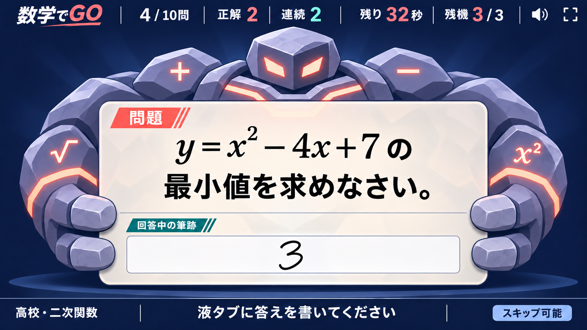
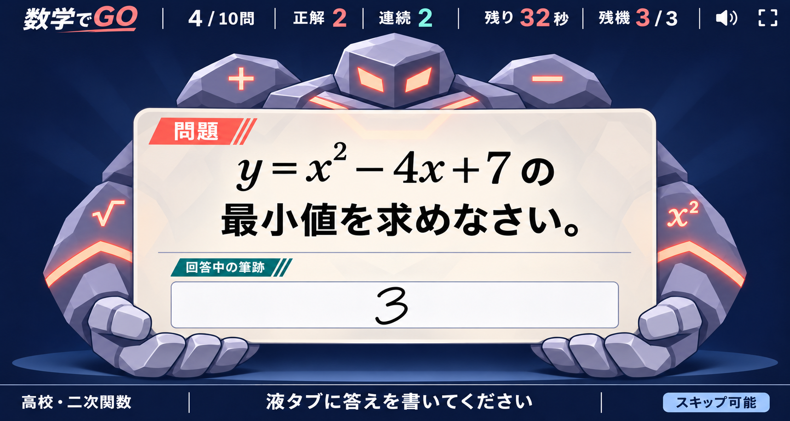
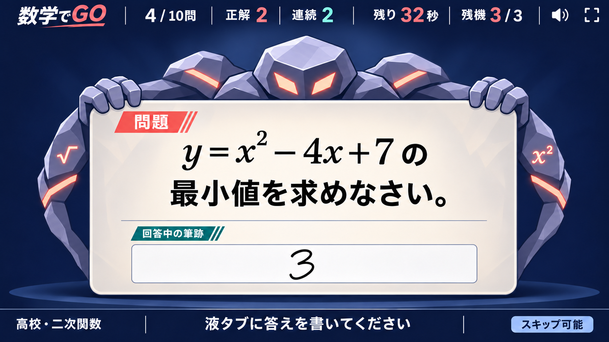
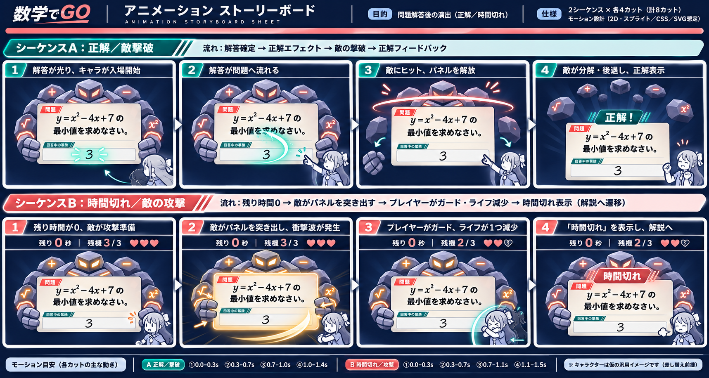

# モニター画面・数式バトル案

更新日：2026-11-06。文化祭の来場者と観客が、問題を解く行為を「敵への攻撃」として直感的に楽しめるモニター表示の設計案です。液タブの入力操作は大きく変えず、モニター側の見せ方と判定演出を強化します。

## 実装基準：敵が問題を持つ中央構図


こちらを実装時の基準案とします。問題と回答中の筆跡を画面中央へまとめ、敵がその問題パネルを背後からつかんでいる構図です。敵の体力や名前は表示しません。問題そのものを敵との対決対象に見立てることで、情報量を増やさずにゲームらしさを出します。

問題面は透明なガラスではなく、乳白色の「透ける紙」とします。中央の問題文付近は約96%不透明、端は84〜88%不透明にし、敵の輪郭は端や余白から見せます。敵の顔・肩・腕は問題面の背面、指だけは前面へ置きます。これにより数式へ敵の模様が重ならず、つかんでいる形も明確になります。

画面を縮小した場合も左右分割には戻さず、中央構図を維持します。問題面は横幅`clamp(720px, 74vw, 1420px)`を基準とし、縦画面では敵の胴体を隠して顔と両手だけを残します。問題文は最低28px、主要数式は最低40pxを確保し、長文では敵ではなく問題面を先に広げます。

### 3レイヤーでの再現方法

1. 背面：敵の頭・肩・腕をまとめた透過WebP
2. 中央：HTMLとKaTeXで描画する問題・筆跡パネル
3. 前面：左右の手と指だけを切り出した透過WebP

3枚を同じ基準枠へ`position: absolute`で重ね、`z-index`だけで前後関係を作ります。敵をCanvasへ描き直す必要はなく、現在のDOM中心の構成へ追加できます。問題面の例は次のとおりです。

```css
.held-problem-panel {
  background: linear-gradient(
    90deg,
    rgb(255 253 247 / 86%),
    rgb(255 253 247 / 96%) 24% 76%,
    rgb(255 253 247 / 86%)
  );
  backdrop-filter: blur(10px);
  border: 1px solid rgb(16 27 61 / 18%);
  box-shadow: 0 18px 42px rgb(2 8 24 / 28%);
}
```

`backdrop-filter`が使えない環境では、同じ背景を96%不透明の単色へ切り替えます。敵の模様が文字領域へ入る場合は透過率を下げるのではなく、背面画像側の中央を暗くしない・情報量を減らすことで対応します。本文と背景のコントラストは4.5:1以上を実機で確認します。

## 問題パネルの持ち方・比較案

どの案も、背面の敵・中央のDOMパネル・前面の手という同じ3レイヤーで実装します。敵ごとにHTML構造を変えず、スプライトと手のアンカー座標だけを差し替えられることを採用条件とします。

### A：両脇から抱える



腕が画面の左右を囲むため、敵の存在感が最も強い案です。前面に出すのは左右2本ずつの指だけとし、筆跡欄を隠しません。横長モニターとの相性が良く、現在の基準案から最も少ない変更で導入できます。

### B：下から持ち上げる



問題を「敵が差し出している」意味が最も伝わりやすく、安定したシルエットになります。一方、手が筆跡欄へ近いため、長い筆跡を表示する場合は下端へ最低48pxの安全余白が必要です。小型モニターでは手を0.82倍まで縮小します。

### C：上からつかまる



接点を上端へ集めることで、問題文の下半分と筆跡欄を最も広く使える案です。敵の指を上部ラベルの外側へ固定すれば、長文問題にも対応しやすくなります。縦画面では腕を非表示にして、顔と指だけを残せます。

| 案 | 視認性 | 敵の存在感 | レスポンシブ対応 | 制作負荷 | 向いている用途 |
|---|---|---|---|---|---|
| A：両脇 | 高い | 最も強い | 横長画面で特に安定 | 低 | 通常敵・大型敵 |
| B：下支え | 高い | 強い | 下端の安全余白が必要 | 低 | 重量感のある敵 |
| C：上つかみ | 最も高い | 中程度 | 縦画面・長文に強い | 最も低い | 素早い敵・小型敵 |

実装の第一候補はAです。BとCを敵の種類として混在させる場合も、手の接点を`--grip-left-x`、`--grip-right-x`、`--grip-y`のCSSカスタムプロパティで管理し、画面ごとの個別CSSを増やしません。

### 現実的な技術構成

推奨構成は、現在のTypeScript / Vite / DOM / KaTeXを維持し、演出層だけを追加する方法です。

- HUD・問題・筆跡・案内：HTML、CSS Grid、KaTeX
- 敵：透過WebPのスプライトシート。`idle`、`appear`、`hit`、`defeat`、`attack`、`escape`の6種類
- 待機・被弾：CSS AnimationsまたはWeb Animations API
- 攻撃軌跡：SVG pathと`stroke-dashoffset`
- 破片：Canvas 2Dで最大20個。撃破時だけ約700ms描画
- 複数演出の時系列制御：必要になった段階でMotionのmini版を追加

Motionのmini版はHTML・SVGのアニメーションに絞った小さな構成を提供しており、現行DOMへ部分導入できます。敵や破片を数十体以上へ増やす場合だけ、右側の敵領域をPixiJSへ置き換えます。PixiJSのParticleContainerは大量の軽量パーティクル向けですが、この展示の20個程度では導入しません。Phaserはスプライトアニメーションを標準で扱えますが、画面全体のゲームループと状態管理を持つため、現行Sessionとの責務重複が大きく、全面移行時以外は採用しません。

公式資料： [Motion animate](https://motion.dev/docs/animate) / [PixiJS ParticleContainer](https://pixijs.com/8.x/guides/components/scene-objects/particle-container) / [Phaser Sprite](https://docs.phaser.io/phaser/concepts/gameobjects/sprite)

### 制作量の目安

- 敵1体：6アニメーション、合計40〜55フレーム、1枚のWebPアトラス
- SVG：攻撃軌跡、命中マークの2点
- 効果音：出現、命中、撃破、反撃、離脱の5点
- 実装：敵表示コンポーネント、状態Presenter、演出キュー、reduced-motion対応
- 最初の検証対象：1体、難易度1、正解・誤答・時間切れ・スキップの4分岐

以下の画像は、演出方向を強く確認するために作成した初期コンセプトです。画面構造の実装基準にはせず、敵の造形と撃破表現の参考に限定します。


## 基本ルール

- 1問を1体の「数式魔獣」として表現します。
- 問題文は中央の乳白色面へ固定し、数メートル離れても読める大きさを最優先します。
- 敵は問題面の背後へ置き、顔・肩・両腕と前面の手だけを見せます。問題文・残り時間・残機は隠しません。
- 回答中の筆跡は小さな同期欄に表示し、手元で戦っていることを観客にも伝えます。
- 正解したときだけ回答の式が光の軌跡となり、問題面へ命中して敵を撃破します。
- 誤答は攻撃が敵の防壁で弾かれる表現にし、残機が減らない現在のルールを守ります。
- 時間切れは敵の反撃で残機が1つ減ります。
- スキップは敵を倒さず青いゲートから戦闘を離脱します。残機は減りません。

## 判定アニメーション


| 状態 | 画面上の動き | ゲーム上の意味 |
|---|---|---|
| 正解 | 回答の式が筆跡欄から問題面へ飛ぶ → 命中 → 敵がパネルを離して数式ブロックへ分解 | 問題を撃破。連続正解の光と音程を1段上げる |
| 誤答 | 攻撃が防壁で弾かれ、敵が短く身構える | 残機は減らさず、同じ問題へ再挑戦 |
| 時間切れ | 時計が0になる → 敵の反撃波 → 残機アイコンが1つ割れる | 現行どおり残機−1。正答と解説へ進む |
| スキップ | 青いゲートが開き、敵が粒子化して退場 | 敗北扱いにせず、残機を保って正答と解説へ進む |

正解演出は約1.2秒、誤答は約0.45秒、時間切れは約0.9秒、スキップは約0.65秒を目安にします。演出中も判定文を同時に表示し、色や音だけへ依存しません。動きを減らす設定では、粒子と揺れを止め、アイコンと判定文だけを残します。

## 女の子キャラクターを含む演出設計



女の子は液タブ利用者の分身として扱います。ただし回答中へ常時重ねると中央パネルの安全領域を狭めるため、通常時は画面外で待機し、判定が確定して入力が止まった瞬間だけ右下から登場させます。登場中も画面高の25%を上限とし、問題文と筆跡には重ねません。最終キャラクター画像は後から差し替えられるよう、アニメーションは骨格変形ではなく「ポーズ画像の切り替え＋全体の移動」で構成します。絵コンテ内の女の子は配置と動きだけを示す仮画像です。

### 最低限必要なキャラクター画像

| 画像 | 使用場面 | 必須度 |
|---|---|---|
| `idle` | ゲーム開始・結果画面へのつなぎ | 任意 |
| `cast` | 正解時に答えを放つ | 必須 |
| `guard` | 時間切れの攻撃を受け止める | 必須 |
| `celebrate` | 撃破後の短い喜び | 必須 |
| `surprised` | 誤答時の小さな反応 | 任意 |

すべて同じキャンバス寸法と足元基準点で、背景・発光・床影を含めない透過WebPまたはPNGにします。キャラクターは敵のいる左上方向を向かせます。表情差分を別レイヤーにする必要はなく、まず`cast`、`guard`、`celebrate`の3枚で成立させられます。

### 正解・敵撃破（合計約1.35秒）

1. **0〜120ms**：筆跡欄の回答がティール色で確定し、女の子を`cast`のポーズで右下から登場させます。
2. **120〜380ms**：回答の数式を複製したSVGが、筆跡欄から問題面中央へ弧を描いて移動します。連続正解数に応じて音程と軌跡の太さだけを3段階まで上げます。
3. **380〜620ms**：命中点から問題パネルの輪郭へ光が走り、敵の指が8〜14pxだけ開きます。画面全体は揺らさず、敵レイヤーだけを短く後退させます。
4. **620〜980ms**：敵を6〜10個の大きな数式ブロックへ分解し、下ではなく奥へ縮小させます。細かな粒子は最大12個に限定します。
5. **980〜1350ms**：女の子を`celebrate`へ切り替え、「正解！」と連続数を表示してから次の問題へつなぎます。

撃破の主役は「女の子が答えを放つ→敵が問題を手放す」という因果関係です。爆発や大量の紙吹雪を重ねず、連続正解時だけ背景のスポットライトを一段明るくします。

### 時間切れ・敵の攻撃（合計約1.05秒）

1. **0〜140ms**：タイマーを0で固定し、進行バーを橙色へ変えます。敵の目と手の数式模様を一度だけ強く発光させます。
2. **140〜360ms**：敵が問題パネルを押し出すように8px前進し、パネル外周から幅広い衝撃波を女の子へ送ります。細いレーザーではなく、半透明の弧で子どもにも攻撃方向を伝えます。
3. **360〜600ms**：女の子を`guard`へ切り替え、キャラクターと足元影だけを6px後退させます。赤い全画面フラッシュは避け、画面端を一度だけ淡い橙色にします。
4. **600〜850ms**：残機アイコン1個をひび割れ状態へ切り替え、「時間切れ」を文字でも表示します。
5. **850〜1050ms**：敵と女の子を通常位置へ戻し、正答・解説画面へ移ります。

攻撃表現は驚かせるためではなく、時間切れと残機減少の因果関係を説明するために使います。大きな画面揺れ、白い全画面フラッシュ、大音量の衝撃音は採用しません。

### 誤答（約520ms）

回答SVGが問題面へ届く直前で柔らかい防壁に弾かれ、筆跡欄へ戻ります。敵は指へ力を入れ、女の子は任意の`surprised`へ短く切り替えます。「もう一度！」を同時に表示し、残機が減らないことを明示します。再入力可能になるまでの待ち時間は520msを上限にします。

### スキップ（約700ms）

女の子が問題面へ手を向け、青いページ送りの帯が左から右へ通過します。敵は倒れず、パネルを抱えたまま奥へ縮小して退場します。「スキップ」を表示し、正解・撃破と同じ色や音を使いません。

### 回答中の待機動作

- 敵：3.2秒周期で上下2px、指を1px動かすだけにする
- 女の子：回答中は画面外で待機し、画像だけ先読みする
- 問題面：動かさない。問題を読む際の基準面を固定する
- タブが非表示になった場合：すべての待機アニメーションを停止する

### 実装方法と性能上限

演出は既存の状態から`idle`、`correct`、`incorrect`、`timedOut`、`skipped`を受け取る`BattleAnimationDirector`へ集約します。`Element.animate()`を使ったWeb Animations APIで順番を制御し、状態遷移中に別イベントが来た場合は現在の演出をキャンセルして最終状態へ移します。新しいアニメーションライブラリは不要です。

- 同時に動かすDOM要素：24個以内
- 粒子：12個以内
- ぼかし：最大12px、問題面の固定領域だけ
- キャラクター・敵画像：各ポーズWebPで300KB程度を目標
- 次に使うポーズ：難易度選択中に先読み
- `prefers-reduced-motion`：軌跡・後退・分解を省略し、ポーズ、色、判定文の切り替えだけを残す

女の子画像を受け取った段階では、絵柄に合わせて移動量と発光色を調整します。画像そのものへエフェクトを焼き込まないことで、キャラクター差し替え時もタイムラインを再実装せずに済みます。

## 敵の構成

最初から問題ごとに別キャラクターを用意すると制作・保守コストが大きいため、難易度ごとに1体、合計7体を基本とします。同じ難易度では、色、数式ブロック、目の形、台座エフェクトを問題カテゴリに応じて変えます。

1. 数の精：数字と加減算の小型モンスター
2. 分数甲虫：分数・割合の装甲を持つ敵
3. 方程式魔獣：文字式のブロックで構成された敵
4. 関数竜：グラフの軌跡をまとった敵
5. 微積コア：回転する極限・微分記号の敵
6. 行列巨兵：行列ブロックが組み替わる大型の敵
7. 証明の虚像：抽象記号が輪郭を作る最終難易度の敵

## 実装方針

Phaser、Three.js、モーションライブラリは追加せず、既存のDOM・SVG・CSSアニメーションで実現できます。

- 敵本体：透過WebPまたは透過PNG。難易度ごとに通常・被弾・撃破の3状態を用意します。
- 攻撃軌跡・命中マーク：SVG。色、長さ、破砕位置をCSSカスタムプロパティで変更します。
- 粒子：最大20個程度のDOM要素を再利用し、`transform`と`opacity`だけで移動します。
- 進行連携：`Session`の`writing`、`judging`、`result`、`timedOut`、`skipped`を演出状態へ変換する専用Presenterを追加します。
- 2画面同期：判定結果と問題IDは既に共有されているため、画像や粒子座標を通信せず、モニター側で同じ状態から演出を再生します。
- 長文問題：問題面の高さを広げ、敵の胴体を背面へ隠します。さらに長い場合は顔と両手だけを残し、問題文を優先します。
- 性能：画像は各難易度の開始時に先読みし、同時アニメーション数を制限します。GPU認識処理とは独立したCSS合成に留めます。

## 段階的な導入

1. 現在の1体を使い、正解・誤答・時間切れ・スキップの4演出を実装します。
2. 10問通しで数式の読みやすさ、音量、演出時間、画面落ちを実機確認します。
3. 難易度別の7体へ展開し、カテゴリ別の部品差し替えを追加します。
4. 最後にボス問題、連続正解の強化演出、結果画面の撃破一覧を追加します。

この順序なら、先にゲーム体験の核を検証でき、キャラクター制作後に演出設計を作り直すリスクを抑えられます。
