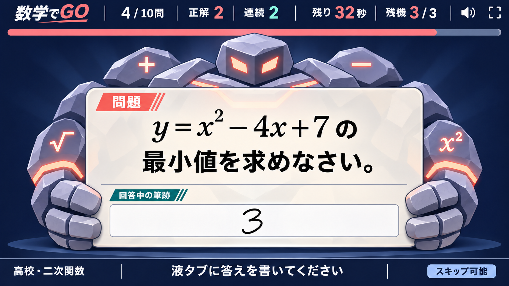
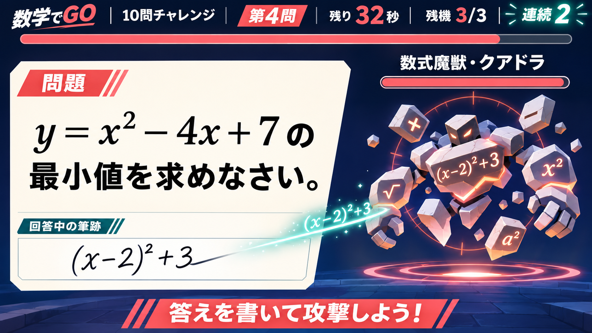
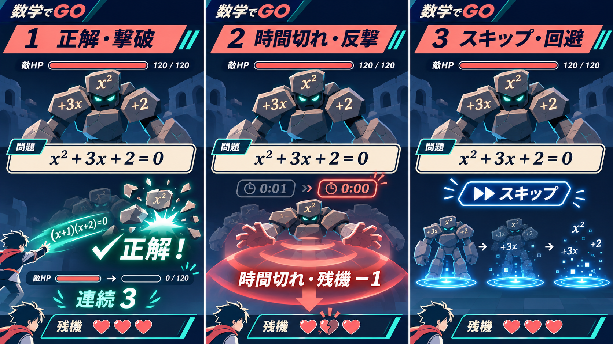

# モニター画面・数式バトル案

更新日：2026-11-06。文化祭の来場者と観客が、問題を解く行為を「敵への攻撃」として直感的に楽しめるモニター表示の設計案です。液タブの入力操作は大きく変えず、モニター側の見せ方と判定演出を強化します。

## 実装基準：敵が問題を持つ中央構図



こちらを実装時の基準案とします。問題と回答中の筆跡を画面中央へまとめ、敵がその問題パネルを背後からつかんでいる構図です。敵の体力や名前は表示しません。問題そのものを敵との対決対象に見立てることで、情報量を増やさずにゲームらしさを出します。

問題面は透明なガラスではなく、乳白色の「透ける紙」とします。中央の問題文付近は約96%不透明、端は84〜88%不透明にし、敵の輪郭は端や余白から見せます。敵の顔・肩・腕は問題面の背面、指だけは前面へ置きます。これにより数式へ敵の模様が重ならず、つかんでいる形も明確になります。

画面を縮小した場合も左右分割には戻さず、中央構図を維持します。問題面は横幅`clamp(720px, 74vw, 1420px)`を基準とし、縦画面では敵の胴体を隠して顔と両手だけを残します。問題文は最低28px、主要数式は最低40pxを確保し、長文では敵ではなく問題面を先に広げます。

### 3レイヤーでの再現方法

1. 背面：敵の頭・肩・腕をまとめた透過WebP
2. 中央：HTMLとKaTeXで描画する問題・筆跡パネル
3. 前面：左右の手と指だけを切り出した透過WebP

3枚を同じ基準枠へ`position: absolute`で重ね、`z-index`だけで前後関係を作ります。敵をCanvasへ描き直す必要はなく、現在のDOM中心の構成へ追加できます。問題面の例は次のとおりです。

```css
.held-problem-panel {
  background: linear-gradient(
    90deg,
    rgb(255 253 247 / 86%),
    rgb(255 253 247 / 96%) 24% 76%,
    rgb(255 253 247 / 86%)
  );
  backdrop-filter: blur(10px);
  border: 1px solid rgb(16 27 61 / 18%);
  box-shadow: 0 18px 42px rgb(2 8 24 / 28%);
}
```

`backdrop-filter`が使えない環境では、同じ背景を96%不透明の単色へ切り替えます。敵の模様が文字領域へ入る場合は透過率を下げるのではなく、背面画像側の中央を暗くしない・情報量を減らすことで対応します。本文と背景のコントラストは4.5:1以上を実機で確認します。

### 現実的な技術構成

推奨構成は、現在のTypeScript / Vite / DOM / KaTeXを維持し、演出層だけを追加する方法です。

- HUD・問題・筆跡・案内：HTML、CSS Grid、KaTeX
- 敵：透過WebPのスプライトシート。`idle`、`appear`、`hit`、`defeat`、`attack`、`escape`の6種類
- 待機・被弾：CSS AnimationsまたはWeb Animations API
- 攻撃軌跡：SVG pathと`stroke-dashoffset`
- 破片：Canvas 2Dで最大20個。撃破時だけ約700ms描画
- 複数演出の時系列制御：必要になった段階でMotionのmini版を追加

Motionのmini版はHTML・SVGのアニメーションに絞った小さな構成を提供しており、現行DOMへ部分導入できます。敵や破片を数十体以上へ増やす場合だけ、右側の敵領域をPixiJSへ置き換えます。PixiJSのParticleContainerは大量の軽量パーティクル向けですが、この展示の20個程度では導入しません。Phaserはスプライトアニメーションを標準で扱えますが、画面全体のゲームループと状態管理を持つため、現行Sessionとの責務重複が大きく、全面移行時以外は採用しません。

公式資料： [Motion animate](https://motion.dev/docs/animate) / [PixiJS ParticleContainer](https://pixijs.com/8.x/guides/components/scene-objects/particle-container) / [Phaser Sprite](https://docs.phaser.io/phaser/concepts/gameobjects/sprite)

### 制作量の目安

- 敵1体：6アニメーション、合計40〜55フレーム、1枚のWebPアトラス
- SVG：攻撃軌跡、命中マークの2点
- 効果音：出現、命中、撃破、反撃、離脱の5点
- 実装：敵表示コンポーネント、状態Presenter、演出キュー、reduced-motion対応
- 最初の検証対象：1体、難易度1、正解・誤答・時間切れ・スキップの4分岐

以下の画像は、演出方向を強く確認するために作成した初期コンセプトです。画面構造の実装基準にはせず、敵の造形と撃破表現の参考に限定します。



## 基本ルール

- 1問を1体の「数式魔獣」として表現します。
- 問題文は中央の乳白色面へ固定し、数メートル離れても読める大きさを最優先します。
- 敵は問題面の背後へ置き、顔・肩・両腕と前面の手だけを見せます。問題文・残り時間・残機は隠しません。
- 回答中の筆跡は小さな同期欄に表示し、手元で戦っていることを観客にも伝えます。
- 正解したときだけ回答の式が光の軌跡となり、問題面へ命中して敵を撃破します。
- 誤答は攻撃が敵の防壁で弾かれる表現にし、残機が減らない現在のルールを守ります。
- 時間切れは敵の反撃で残機が1つ減ります。
- スキップは敵を倒さず青いゲートから戦闘を離脱します。残機は減りません。

## 判定アニメーション



| 状態 | 画面上の動き | ゲーム上の意味 |
|---|---|---|
| 正解 | 回答の式が筆跡欄から問題面へ飛ぶ → 命中 → 敵がパネルを離して数式ブロックへ分解 | 問題を撃破。連続正解の光と音程を1段上げる |
| 誤答 | 攻撃が防壁で弾かれ、敵が短く身構える | 残機は減らさず、同じ問題へ再挑戦 |
| 時間切れ | 時計が0になる → 敵の反撃波 → 残機アイコンが1つ割れる | 現行どおり残機−1。正答と解説へ進む |
| スキップ | 青いゲートが開き、敵が粒子化して退場 | 敗北扱いにせず、残機を保って正答と解説へ進む |

正解演出は約1.2秒、誤答は約0.45秒、時間切れは約0.9秒、スキップは約0.65秒を目安にします。演出中も判定文を同時に表示し、色や音だけへ依存しません。動きを減らす設定では、粒子と揺れを止め、アイコンと判定文だけを残します。

## 敵の構成

最初から問題ごとに別キャラクターを用意すると制作・保守コストが大きいため、難易度ごとに1体、合計7体を基本とします。同じ難易度では、色、数式ブロック、目の形、台座エフェクトを問題カテゴリに応じて変えます。

1. 数の精：数字と加減算の小型モンスター
2. 分数甲虫：分数・割合の装甲を持つ敵
3. 方程式魔獣：文字式のブロックで構成された敵
4. 関数竜：グラフの軌跡をまとった敵
5. 微積コア：回転する極限・微分記号の敵
6. 行列巨兵：行列ブロックが組み替わる大型の敵
7. 証明の虚像：抽象記号が輪郭を作る最終難易度の敵

## 実装方針

Phaser、Three.js、モーションライブラリは追加せず、既存のDOM・SVG・CSSアニメーションで実現できます。

- 敵本体：透過WebPまたは透過PNG。難易度ごとに通常・被弾・撃破の3状態を用意します。
- 攻撃軌跡・命中マーク：SVG。色、長さ、破砕位置をCSSカスタムプロパティで変更します。
- 粒子：最大20個程度のDOM要素を再利用し、`transform`と`opacity`だけで移動します。
- 進行連携：`Session`の`writing`、`judging`、`result`、`timedOut`、`skipped`を演出状態へ変換する専用Presenterを追加します。
- 2画面同期：判定結果と問題IDは既に共有されているため、画像や粒子座標を通信せず、モニター側で同じ状態から演出を再生します。
- 長文問題：問題面の高さを広げ、敵の胴体を背面へ隠します。さらに長い場合は顔と両手だけを残し、問題文を優先します。
- 性能：画像は各難易度の開始時に先読みし、同時アニメーション数を制限します。GPU認識処理とは独立したCSS合成に留めます。

## 段階的な導入

1. 現在の1体を使い、正解・誤答・時間切れ・スキップの4演出を実装します。
2. 10問通しで数式の読みやすさ、音量、演出時間、画面落ちを実機確認します。
3. 難易度別の7体へ展開し、カテゴリ別の部品差し替えを追加します。
4. 最後にボス問題、連続正解の強化演出、結果画面の撃破一覧を追加します。

この順序なら、先にゲーム体験の核を検証でき、キャラクター制作後に演出設計を作り直すリスクを抑えられます。
